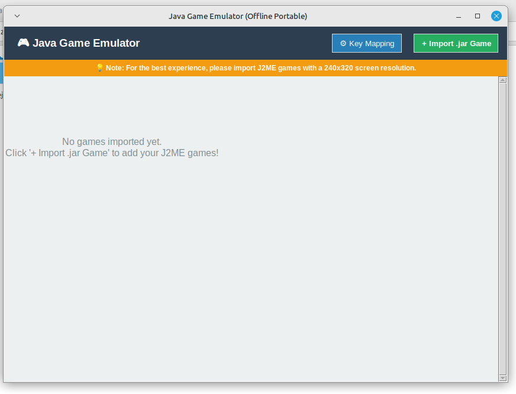
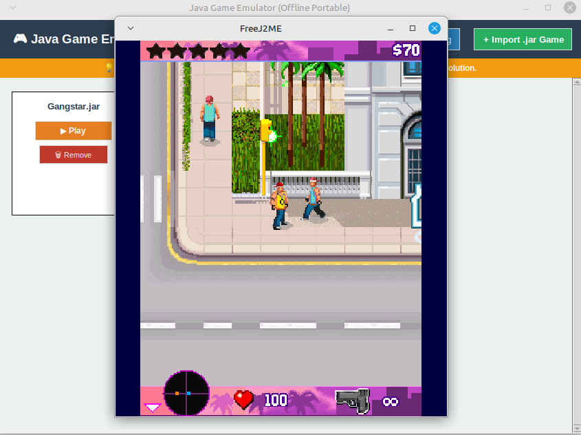
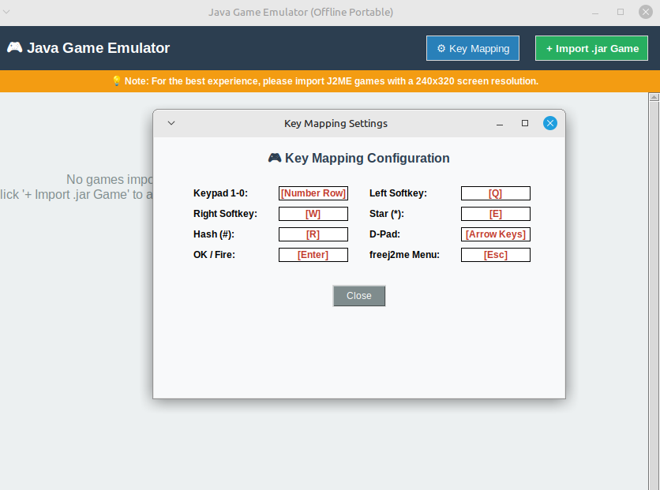

<div align="center">

# Java Game Emulator

**An offline launcher and game library for classic J2ME (`.jar`) mobile games.**

Built with Python and Tkinter, powered by [FreeJ2ME](https://github.com/hex007/freej2me).


</div>

## About

Java Game Emulator brings the feature-phone games of the 2000s to your desktop.
It wraps the FreeJ2ME emulator in a clean game library: import your `.jar`
games once, see them as cards in a grid, and start any of them with one click.

It is designed primarily for **Linux**, where it is available as a ready-to-install
`.deb` package that includes its own Java runtime. It also **runs on Windows**
from source with a few extra setup steps.

## Screenshots

<div align="center">

| Game library | Game running | Key mapping |
|:---:|:---:|:---:|
|  |  |  |

</div>

## Features

- Scrollable grid library with one-click **Play**
- Import `.jar` games with duplicate detection; remove with one click
- Library saved automatically between sessions
- Fully offline, with a portable Java runtime (bundled in the `.deb`)
- Built-in key-mapping reference
- Per-launch log file for diagnosing games that fail to start
- Works on Linux and Windows

> **Tip:** Games with a **240x320** screen resolution work best.
>
> **Note:** No games are included. Use only games you legally own.

---

## Install on Linux (`.deb` package)

For Debian, Ubuntu, Linux Mint and other Debian-based **64-bit (amd64)** systems.

**1. Download the package:**

[](https://github.com/zakariahossen/java-game-emulator/releases/latest)
[](YOUR_GOOGLE_DRIVE_LINK)ow
[](YOUR_DEB_VIDEO_LINK)
[](YOUR_SOURCE_VIDEO_LINK)

**2. Install it** (this also installs the required dependencies):

```bash
sudo apt install ./java-game-emulator_1.0.0_amd64.deb
```

**3. Run it** from your applications menu (**Java Game Emulator**) or a terminal:

```bash
java-game-emulator
```

Then click **+ Import .jar Game**, pick a game, and press **Play**.

To uninstall: `sudo apt remove java-game-emulator`. Your library and save data
stay in `~/.local/share/java-game-emulator/`.

---

## Run from source

Use this if the `.deb` does not work (other distributions, ARM, install errors),
or on Windows. You need **Python 3.8+ with Tkinter** and **Java 21+**.

```bash
git clone https://github.com/YOUR_USERNAME/java-game-emulator.git
cd java-game-emulator
```

### Linux

1. Install Python and Tkinter:

   ```bash
   sudo apt install python3 python3-tk     # Fedora: python3-tkinter | Arch: tk
   ```

2. Download a Linux x64 **JRE** (`.tar.gz`, version 21 or newer) from
   [Adoptium Temurin](https://adoptium.net/temurin/releases/), then extract it
   and rename the folder to **`jre`** inside the project folder:

   ```bash
   tar -xzf OpenJDK*-jre_x64_linux_*.tar.gz
   mv jdk-*-jre jre                 # the extracted name may differ; rename it to jre
   ./jre/bin/java -version          # check: prints the Java version
   ```

   *Alternative:* install Java 21+ system-wide (e.g. `sudo apt install openjdk-21-jre`);
   the app falls back to it automatically.

3. Run:

   ```bash
   python3 emulator.py
   ```

### Windows

1. Install **Python 3.8+** from [python.org](https://www.python.org/downloads/windows/)
   with the default options (this includes Tcl/Tk).
2. Download the project (**Code → Download ZIP**) and extract it.
3. Download a Windows x64 **JRE** (`.zip`, version 21 or newer) from
   [Adoptium Temurin](https://adoptium.net/temurin/releases/), extract it, and
   rename the folder to **`jre-windows`** inside the project folder, so that
   `jre-windows\bin\java.exe` exists.

   *Alternative:* install Java 21+ system-wide (e.g. the Temurin `.msi`);
   the app falls back to it automatically.
4. Start the app: in File Explorer right-click `emulator.py` → **Open with →
   Python**, or run in a terminal inside the project folder:

   ```powershell
   python emulator.py
   ```

> The Java runtime is not part of this repository because of its size, so you
> download it yourself as described above. The app looks for the bundled
> `jre` (Linux) or `jre-windows` (Windows) folder first, then for `java` on `PATH`.

### Controls

Click the game window first so it has keyboard focus.

| Phone key | Keyboard | Phone key | Keyboard |
|---|---|---|---|
| Keypad `1`-`0` | Number row | Star `*` | `E` |
| Left softkey | `Q` | Hash `#` | `R` |
| Right softkey | `W` | D-Pad | Arrow keys |
| OK / Fire | `Enter` | FreeJ2ME menu | `Esc` |

### Troubleshooting

| Problem | Solution |
|---|---|
| `No module named 'tkinter'` | Linux: `sudo apt install python3-tk`. Windows: reinstall Python with Tcl/Tk enabled. |
| "Java not found!" | Add the `jre` / `jre-windows` folder or install Java 21+. |
| Blank window or instant exit | Check `logs/freej2me_last_run.txt` (`~/.local/share/java-game-emulator/logs/` for the `.deb`). Java older than 21 gives `UnsupportedClassVersionError`. |

---

## For developers

`emulator.py` is a single-file Tkinter launcher. It does **not** render games:
FreeJ2ME opens its own window and handles graphics, audio, input and save data.

```
emulator.py              Launcher (UI, library, process management)
freej2me/freej2me.jar    FreeJ2ME emulator (third party)
jre/  jre-windows/       Portable JREs (not in Git; see above)
screenshots/             README images
```

- **Library:** JSON list of `{name, path}` in `games_library.json`; `.jar` only,
  duplicates rejected by normalized absolute path. Removing never deletes the game file.
- **Paths:** resolved from `__file__`. User data goes to the app folder when writable,
  else `~/.local/share/java-game-emulator`. Override with `JAVA_EMULATOR_HOME`.
- **Java lookup:** bundled `jre` / `jre-windows`, then `java` on `PATH`.
- **Launch:** `subprocess.Popen` runs
  `java -jar freej2me.jar <file:// URL> 240 320 1`. FreeJ2ME requires a **`file://`
  URL** (`Path.as_uri()`); a plain path fails silently with a blank window.
  Java2D flags (`d3d=false`, `opengl=false`, `uiScale=1`) avoid blank AWT windows.
  Output goes to `logs/freej2me_last_run.txt`; a 3-second check shows the log tail on early exit.
- **Config:** `LCD_WIDTH`, `LCD_HEIGHT`, `LCD_SCALE`, `GRID_COLUMNS` at the top of the file.
- **Limitations:** the game runs in FreeJ2ME's own window, key mapping is fixed inside
  FreeJ2ME, and bundled JREs are OS-specific. macOS is not supported.

---

## Acknowledgements

Built with and thanks to:

- [**FreeJ2ME**](https://github.com/hex007/freej2me): the emulator that runs the games
- [**Eclipse Temurin**](https://adoptium.net/): the portable Java runtime
- [**Python**](https://www.python.org/) and **Tkinter**: the application and its interface


## Legal

- This project's own code is released under the **GNU GPL v3.0** (see `LICENSE`).
- **FreeJ2ME** (GPL-3.0) is redistributed unmodified with its `LICENSE` file;
  source: <https://github.com/hex007/freej2me>. It uses ObjectWeb ASM, which has its
  own license. **Eclipse Temurin** is licensed GPL-2.0 with the Classpath Exception.
- **No games are included.** J2ME games are copyrighted by their publishers; use
  only games you own or that are freely licensed, and do not distribute others.
- Java is a trademark of Oracle and/or its affiliates. This project is independent and
  not affiliated with Oracle, FreeJ2ME, or any game publisher.
- Provided "as is", without warranty.
